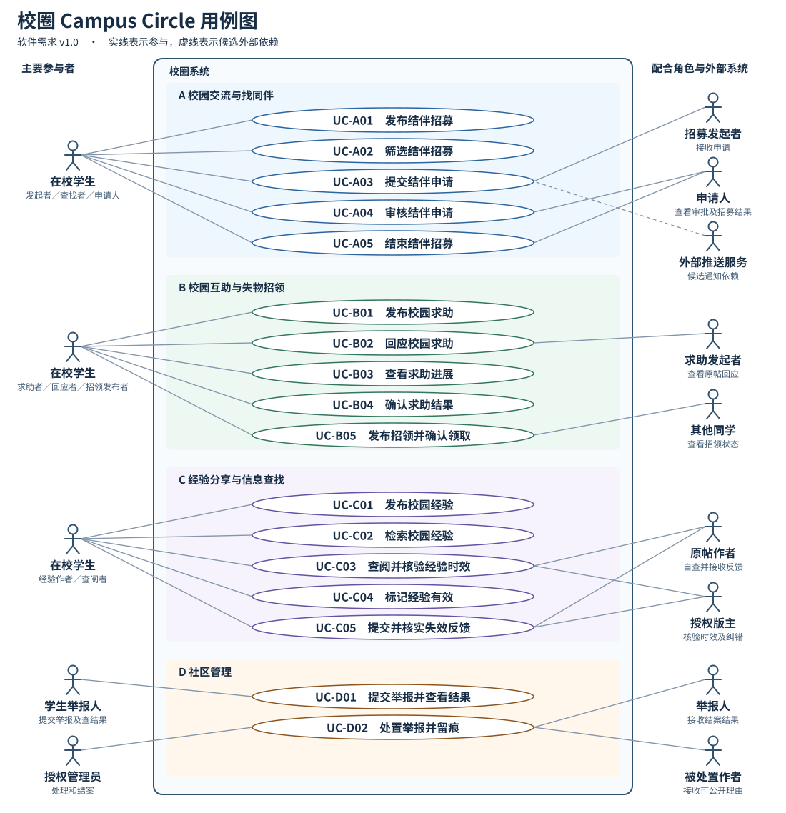

# 校圈软件需求规格说明书

版本 **v1.0** · 基线日期 **2026-11-27** · 维护人 [aserssi](https://github.com/aserssi)

[用例图](srs-use-cases.svg) · [需求追溯矩阵初版](requirements-traceability.md) · [调研汇总](02-preliminary-research.md) · [故事 Issue](https://github.com/aserssi/se-design-campus-circle/issues?q=is%3Aissue+label%3Astory)

本规格用于校圈课程项目的开发、测试和需求验收。范围覆盖面向同济在校学生的结伴招募、校园求助和失物招领、经验检索与核验、举报处置。基线收录 17 条功能需求和 3 条非功能需求。表中角色按实际操作区分，同一名学生可担任多个角色。

| 干系人 | 目标与用例 |
| --- | --- |
| 在校学生 | 作为招募发起者、申请人、求助发起者、回应者、招领发布者、经验作者或查阅者，使用 UC-A01 至 UC-C05，也可通过 UC-D01 举报并查看结果。 |
| 社区管理员或授权版主 | 通过 UC-D02 处理举报，通过 UC-C03 和 UC-C05 核验经验及读者反馈。权限边界见 NFR-D04，试点人员和委派范围待确认。 |
| 通知链路维护人员 | 通过 UC-A03、UC-A04 的通知场景验证中断、恢复和补送，运行验收依据 NFR-D05。具体责任人、推送服务和恢复判据待试点核实。 |
| 资源承担方与校方监管方 | 实际是否涉及、权限及职责待组长确认。确认适用后按需求变更流程补相应故事并更新矩阵。 |

## 1. 功能需求

**FR** 为需求编号，**UC** 为对应的用例编号。每节保留关联故事的验收场景。用例图外侧标示主参与者和配合对象，外部推送服务是候选依赖。

### A 校园交流与找同伴

#### FR-A01 发布结伴招募

**用例** `UC-A01` · **故事** [#18](https://github.com/aserssi/se-design-campus-circle/issues/18)

作为希望寻找学习或课外活动伙伴的在校学生，我想发布结构化的结伴需求（包含分类、主题描述、校区、目标人数和截止时间），以便快速吸引契合目标的同学加入，并在到期后自动停止接收申请。

**验收标准**

- **正常发布（默认与自定义截止时间）**
  - Given：我已登录校圈账号，进入“找同伴”发布页面，表单默认预填截止时间为当前日期起第 7 天 23:59。
  - When：我选择分类“自习/备考”、填写主题与描述、选择校区“四平路校区”、设置目标总人数为 `3`（保留默认截止时间或修改为未来某一有效时间，如 `2026-12-01 20:00`）并提交。
  - Then：系统生成一条状态为「招募中」的帖子，详情页展示发起者默认占 1 席（当前进度 `1/3`）以及所设定的截止时间；到达该截止时间后，帖子自动停止接受新申请，状态流转为「已结束」。
- **人数下限与必填校验**
  - Given：我已登录并处于发布页面。
  - When：我未填写主题描述，或将目标总人数设为 `1`（或 `0`、负数）后点击提交。
  - Then：系统拒绝创建帖子并提示“请填写完整主题，且目标总人数至少为 2 人”。
- **自动到期时待审批申请处理**
  - Given：我发布的「招募中」帖子已到达设定的截止时间，且队列中仍有账号 B 提交的一条「待审批」申请。
  - When：系统到达截止时间并触发自动结束；随后发起者尝试在管理页点击同意账号 B，同时账号 B 打开自己的“我的申请”记录。
  - Then：帖子自动流转为「已结束」并停止接受新申请；账号 B 原「待审批」申请自动变为「已关闭（招募已到期）」；发起者点击批准时系统拒绝操作并提示“招募已到期”；账号 B 在个人申请记录中看到该申请状态为「已关闭（招募已到期）」。

**调研依据**

- [OBS-A01 跨校区与课程群找队友信息沉底观察](06-campus-exchange-and-partner.md#obs-a01-跨校区与课程群找队友信息沉底观察)
- [INT-A01 期末自习找同伴的隐私顾虑](06-campus-exchange-and-partner.md#int-a01-期末自习找同伴的隐私顾虑)

#### FR-A02 筛选结伴招募

**用例** `UC-A02` · **故事** [#19](https://github.com/aserssi/se-design-campus-circle/issues/19)

作为正在寻找队伍的在校学生，我想按校区、活动分类及招募状态进行组合筛选，自动过滤已成队或已到期的帖子，以便快速找到当前仍有空位且适合自己的队伍。

**验收标准**

- **三项组合筛选与到期过滤**
  - Given：在正常负载环境下，找同伴列表库中存在 4 条帖子：帖子 1（嘉定校区、课程大作业、招募中、未到期）、帖子 2（嘉定校区、课程大作业、招募中但已过截止时间）、帖子 3（嘉定校区、课程大作业、已成队）、帖子 4（四平路校区、课程大作业、招募中、未到期）。
  - When：我在筛选栏选择校区“嘉定校区”、分类“课程大作业”，并勾选“仅看招募中”后点击筛选。
  - Then：正常负载下，从点击筛选起 1 秒内，列表首屏仅渲染展示帖子 1（并显示剩余名额），自动排除已到期的帖子 2、已成队的帖子 3 和非目标校区的帖子 4。
- **无匹配空状态**
  - Given：正常负载下，当前库中没有同时满足“嘉定校区 + 兴趣运动 + 招募中（未到期）”的帖子。
  - When：我提交该三项组合筛选条件。
  - Then：正常负载下，1 秒内首屏展示空态提示“暂无相关招募，你可以发起一个”，不展示过期或无关帖子。

**调研依据**

- [OBS-A01 跨校区与课程群找队友信息沉底观察](06-campus-exchange-and-partner.md#obs-a01-跨校区与课程群找队友信息沉底观察)

#### FR-A03 提交结伴申请

**用例** `UC-A03` · **故事** [#20](https://github.com/aserssi/se-design-campus-circle/issues/20)

作为有意加入队伍的在校学生，我想向发起者提交仅双方可见的申请附言，并自主独立决定入队后是否分享个人联系方式，以便发起者评估匹配度，同时防止未授权用户获取我的附言或微信号/手机号。

**验收标准**

- **提交申请与隐私隔离（三视角核对）**
  - Given：账号 B 打开账号 A 发布的未到期「招募中」帖子，此前未申请过该帖；双方对各自联系方式的分享选择相互独立。
  - When：账号 B 点击“申请加入”，填写附言并选择“暂不提供微信号，入队后使用站内联系”（或勾选“入队后向发起者分享微信号”并填写），点击提交。
  - Then：系统提示申请已提交，原帖对账号 B 显示“已申请，待处理”。分别用三个账号核对界面与接口返回：
    1. **发起者账号 A**：在申请管理列表中看到该申请及附言；在审批通过前，看不到账号 B 的微信号/手机号。
    2. **申请人账号 B**：可看到自己的申请记录与状态。
    3. **无关学生账号 C**：正常查看公开招募详情及评论时，页面和接口响应均不含账号 B 的附言或联系方式。越权请求账号 B 的私有申请时，接口返回 `403`，响应不含上述私密字段。
- **不留微信号可继续组队与防重复提交**
  - Given：账号 B 未填微信号并已提交一条「待审批」申请。
  - When：账号 B 再次点击提交申请；以及随后发起者 A 同意账号 B 入队。
  - Then：重复提交请求被系统拦截并提示“已提交过申请”，后台不新增第二条记录，也不向发起者重复发送通知；账号 A 同意后，账号 B 正常入队（不因未提供微信号受阻），双方可通过校圈站内消息继续沟通。

**调研依据**

- [INT-A01 期末自习找同伴的隐私顾虑](06-campus-exchange-and-partner.md#int-a01-期末自习找同伴的隐私顾虑)

#### FR-A04 审核结伴申请

**用例** `UC-A04` · **故事** [#21](https://github.com/aserssi/se-design-campus-circle/issues/21)

作为结伴发起者，我想在管理页审核待处理申请，入队后按每个人自己的授权向对方展示本人联系方式并在满员时自动锁定招募，以便避免最后名额被多人重复占用并建立组队联系。

**验收标准**

- **顺序审批最后 1 席与满员锁定**
  - Given：发起者 A 的招募帖目标总人数为 3 人，当前进度为 `2/3`（状态「招募中」），队列中有账号 C 与账号 D 两条「待审批」申请。
  - When：发起者 A 在管理页先点击同意账号 C 加入。
  - Then：当前人数更新为 `3/3`，账号 C 成功入队，状态由「招募中」自动变为「已成队」，前台关闭新申请入口；账号 D 的待审批申请自动变更为「已失效（名额已满）」，无法再被同意入队。
- **并发审批最后 1 席**
  - Given：招募帖目标总人数为 3 人，当前进度为 `2/3`，队列中同时有账号 C 与账号 D 两条「待审批」申请。
  - When：发起者 A 对最后 1 席几乎同时并发触发“同意 C”与“同意 D”两个请求。
  - Then：系统串行锁定剩余名额，最终**恰好一人成功入队**（总人数严格保持 `3/3`、状态变为「已成队」），另一人的申请自动变为「已失效（名额已满）」，且后处理的审批请求返回名额已满提示，不会超员。
- **单向独立的联系方式授权展示**
  - Given：发起者 A 与申请人各自独立设置是否向已入队同伴分享联系方式；账号 C 在申请时勾选“同意分享微信号”，发起者 A 设置为“未同意分享微信号”，账号 D 为未获准申请人。
  - When：发起者 A 同意账号 C 入队后，分别用发起者 A、获准申请人 C 和未获准申请人 D 三个账号查看详情及接口返回。
  - Then：发起者 A 可看到账号 C 分享的微信号；账号 C 看不到发起者 A 的微信号（双方可通过校圈站内消息联系）；未获准申请人 D 看不到发起者 A 与账号 C 任何一方的联系方式。
- **非发起者越权审批拦截**
  - Given：普通账号 E 打开账号 A 发布的招募帖详情或尝试访问审批接口。
  - When：账号 E 尝试查看申请列表或提交“同意申请”请求。
  - Then：系统返回 403 拒绝访问，不返回申请名单、附言及联系方式，帖子人数与申请状态均不发生变更。

**调研依据**

- [INT-A02 兴趣运动约球满员与状态失效](06-campus-exchange-and-partner.md#int-a02-兴趣运动约球满员与状态失效)
- [INT-A01 期末自习找同伴的隐私顾虑](06-campus-exchange-and-partner.md#int-a01-期末自习找同伴的隐私顾虑)

#### FR-A05 结束结伴招募

**用例** `UC-A05` · **故事** [#22](https://github.com/aserssi/se-design-campus-circle/issues/22)

作为结伴发起者，我想在线下已凑齐人员或计划变动时主动结束招募，以便停止接收新申请并告知已申请同学招募结束。

**验收标准**

- **主动结束招募（支持招募中与已成队）**
  - Given：由我发起的帖子当前处于「招募中」（尚有 1 条来自账号 C 的「待审批」申请）或处于「已成队」状态。
  - When：我点击“结束招募”，填写关闭原因（如“线下已凑齐”或“因考试改期活动取消”）并确认。
  - Then：帖子状态流转为「已结束」，详情展示关闭原因与关闭时间；系统关闭新申请入口；原队列中尚未审批的账号 C 申请自动变为「已关闭（招募已结束）」。若原已成队且未取消活动，已入队成员的既有站内联系保留。
- **非发起者越权结帖拦截**
  - Given：普通账号 D 打开他人发起的「招募中」或「已成队」帖子。
  - When：账号 D 尝试提交结束招募请求。
  - Then：系统返回 403 权限拒绝，帖子原状态、申请队列均保持不变。

**调研依据**

- [INT-A02 兴趣运动约球满员与状态失效](06-campus-exchange-and-partner.md#int-a02-兴趣运动约球满员与状态失效)

### B 校园互助与失物招领

#### FR-B01 发布校园求助

**用例** `UC-B01` · **故事** [#5](https://github.com/aserssi/se-design-campus-circle/issues/5)

作为遇到学习或校园生活困难的本校学生，我想说明问题背景和希望得到的帮助，以便同学判断能否给出有针对性的回应。

**验收标准**

- Given：我已登录校圈，准备发布一条学习求助或生活咨询。
- When：我选择相应类别，填写标题、问题背景与所需帮助。若任务涉及当面交付或截止时间，我补填交付地点和截止时间后发布。
- Then：互助列表新增一条帖子，详情显示所填内容和「待回应」，回复数为 0。交付地点和截止时间为选填项，填写后在详情中可见。若缺少所需帮助，提交时提示补全，该次提交不创建帖子。

**调研依据**

- [INT-B01 打印求助与收件确认](05-campus-help-and-followup.md#int-b01-打印求助与收件确认) · [OBS-B01 朋辈答疑](https://youth.tongji.edu.cn/info/1010/3067.htm) · [OBS-B02 求助表达](https://shtjh.tongji.edu.cn/info/1163/4216.htm)

## 需求确认

已补入经同意公开的脱敏访谈摘要，需求由组长 `aserssi` 统一审核确认。

#### FR-B02 回应校园求助

**用例** `UC-B02` · **故事** [#6](https://github.com/aserssi/se-design-campus-circle/issues/6)

作为有相关经验的本校学生，我想在指定求助下给出建议或追问，以便发起者知道这条答复对应自己的问题并能继续沟通。

**验收标准**

- Given：我已登录，并打开一条其他同学发布的「待回应」求助。
- When：我在该帖下提交第一条非空回复，询问解答所需的背景信息或直接给出建议。
- Then：回复出现在该帖详情中，发起者重新打开可看到其内容和提交时间，并能在原帖继续补充。该帖回复数变为 1，状态变为「已有回应」。

**调研依据**

- [INT-B02 回应作业上传求助](05-campus-help-and-followup.md#int-b02-回应作业上传求助) · [OBS-B01 朋辈答疑](https://youth.tongji.edu.cn/info/1010/3067.htm)

## 需求确认

已补入经同意公开的脱敏访谈摘要，需求由组长 `aserssi` 统一审核确认。

#### FR-B03 查看求助进展

**用例** `UC-B03` · **故事** [#7](https://github.com/aserssi/se-design-campus-circle/issues/7)

作为发过校园求助的学生，我想从自己的求助记录查看每条求助的状态和最近回应，以便判断应该继续等待、查看建议还是结束求助。

**验收标准**

- Given：我有三条求助。第一条零回复且尚未确认解决，第二条已有两条回复且尚未确认解决，第三条零回复但我已在线下解决并确认结果。
- When：我打开自己的求助记录。
- Then：第一条显示「待回应」，第二条显示「已有回应」、回复数 2 和最新回复时间，点开后能看到对应回复。第三条显示「已解决」，即使回复数为 0。

**调研依据**

- [INT-B01 打印求助与收件确认](05-campus-help-and-followup.md#int-b01-打印求助与收件确认) · [OBS-B03 进度和结果反馈](https://news.tongji.edu.cn/info/1002/6126.htm) · [OBS-B01 朋辈答疑与进展跟踪](https://youth.tongji.edu.cn/info/1010/3067.htm)

## 需求确认

已补入经同意公开的脱敏访谈摘要，需求由组长 `aserssi` 统一审核确认。

#### FR-B04 确认求助结果

**用例** `UC-B04` · **故事** [#8](https://github.com/aserssi/se-design-campus-circle/issues/8)

作为已经解决问题的求助发起者，我想关闭自己的求助并记录解决方式，以便回应者和后续查看该帖的同学知道问题如何解决。

**验收标准**

- Given：一条求助由我发起且处于「待回应」或「已有回应」，我已实际解决问题，例如线下已收到所需物品。
- When：我填写解决说明并确认「已解决」。
- Then：我的求助记录和帖子详情都显示「已解决」，详情显示解决说明和确认时间，其他同学打开原帖可查看结果。

权限场景

- Given：我已登录并打开他人发起、已有回应且尚未解决的求助。
- When：我尝试提交「已解决」。
- Then：系统拒绝修改，求助仍显示「已有回应」，解决说明和确认时间均未写入。

**调研依据**

- [INT-B01 打印求助与收件确认](05-campus-help-and-followup.md#int-b01-打印求助与收件确认) · [OBS-B03 进度和结果反馈](https://news.tongji.edu.cn/info/1002/6126.htm)

## 需求确认

已补入经同意公开的脱敏访谈摘要，需求由组长 `aserssi` 统一审核确认。

#### FR-B05 发布招领并确认领取

**用例** `UC-B05` · **故事** [#9](https://github.com/aserssi/se-design-campus-circle/issues/9)

作为在校园拾到物品的学生，我想发布招领线索并在确认交还后更新领取状态，以便失主知道如何领取，其他同学也能看出这条招领是否已经完成。

**验收标准**

**场景一｜发布招领线索**

- Given：我已登录，拾到一件物品，并已确认一个可用的交接或领取途径。
- When：我选择「失物招领」，填写物品类别、校区、大致地点、拾到日期和领取途径，例如校内服务点。用于验证失主的独特特征留到认领时核对。
- Then：系统创建招领帖，列表和详情显示「待认领」，详情展示公开线索和领取途径。只填写上述信息即可成功发布。公开记录中没有认领核对细节，表单无需填个人手机号、学号或证件号码。

**场景二｜发布者确认物品已交还**

- Given：我发布的招领帖显示「待认领」，我已通过领取点或认领者的反馈确认物品已实际交还。
- When：我在该帖确认「已领取」。
- Then：系统记录确认时间。其他同学重新打开列表和详情时均能看到「已领取」，详情仍不公开认领核对细节。

**场景三｜他人尝试变更领取状态**

- Given：我作为普通学生打开他人发布的「待认领」招领帖。
- When：我尝试将该帖改为「已领取」。
- Then：系统拒绝修改，列表和详情仍显示「待认领」，且不写入确认时间。

**调研依据**

- [INT-B03 拾物线索与认领核对](05-campus-help-and-followup.md#int-b03-拾物线索与认领核对) · [OBS-B04 失物招领活动记录](https://www.tongji.edu.cn/info/1033/13065.htm) · [同济保卫处失物招领入口](https://baowei.tongji.edu.cn/3063/list.htm)

## 需求确认

已补入经同意公开的脱敏访谈摘要，需求由组长 `aserssi` 统一审核确认。

### C 经验分享与信息查找

#### FR-C01 发布校园经验

**用例** `UC-C01` · **故事** [#11](https://github.com/aserssi/se-design-campus-circle/issues/11)

作为 在校学生（经验分享者/高年级同学），
我想 在发布经验时选择课程代码/院系分类、打上结构化标签（如“复习指南/避坑经验/办事流程”）并标注适用年份/学期，
以便 我的经验能被系统规范归档，方便后来的学弟学妹精准检索，避免在群里反复回答相同问题。

**验收标准**

- Given：经验分享者已登录校圈账号，进入“经验发布”界面；
- When：输入标题与正文，关联课程标签“高数B”、院系标签“数学科学学院”，并在下拉菜单中选择适用学期“2026秋季”，点击“发布经验”；
- Then：系统在 1 秒内保存并发布该经验卡片，卡片顶部展示结构化标签（`#高数B` `#数学科学学院`）与“2026秋季适用”版本标识，且该经验立即可在全站检索库中被筛选。

**调研依据**

- [OBS-001：课程备考与速通经验检索](task-c/evidence.md#观察记录-obs-001课程备考与速通经验检索)
- [F-C01 经验散落严重，缺乏结构化分类](task-c/evidence.md#3-调研发现findings)

#### FR-C02 检索校园经验

**用例** `UC-C02` · **故事** [#12](https://github.com/aserssi/se-design-campus-circle/issues/12)

作为 在校学生（求助者/经验查阅者），
我想 在经验库中输入关键词并按“课程代码”、“所属院系”或“经验类型”进行多维度组合筛选，
以便 在 2 秒内准确定位往期高赞经验，不再在几百条无关闲聊中逐条人肉翻找。

**验收标准**

- Given：学生处于经验检索页面，库中已有历史经验数据；
- When：用户在检索框输入“期中 挽救”，并在筛选栏勾选课程“高数B”与类型“复习指南”，点击提交检索；
- Then：系统在 1.5 秒内返回匹配结果列表（包含高数期中补救相关帖），首屏展示前 10 条结果，结果卡片高亮匹配关键词，并展示发布者、适用年份及点赞数。

**调研依据**

- [OBS-001：课程备考与速通经验检索](task-c/evidence.md#观察记录-obs-001课程备考与速通经验检索)
- [F-C01 经验散落严重，缺乏结构化分类](task-c/evidence.md#3-调研发现findings)

#### FR-C03 查阅并核验经验时效

**用例** `UC-C03` · **故事** [#13](https://github.com/aserssi/se-design-campus-circle/issues/13)

作为 在校学生（选课与办事咨询者），
我想 在浏览涉及培养方案、选课规则或办事流程的历史经验时，看到清晰的时效性状态与过期风险警示，
以便 及时判断该信息是否仍适用于本学年，避免被往年旧政策误导踩坑。

**验收标准**

* **校圈时效预警与核验产品规则**：
  * **预警触发阈值**：当经验分类属于“培养方案/选课规则/办事流程”，其发布时间距当前系统时间超过 180 天（半学年），且没有任何仍在有效窗口内的核验记录，系统判定该帖处于“过期预警”状态。
  * **核验主体、依据与有效窗口区分**：
    * **作者自查（Author Self-Check）**：原帖作者登录后点击【自查现行有效】，依据为“作者个人在读核实确认”，界面展示绿色文字徽章 `【作者自查有效】`，作者自查记录有效 **90 天**（半个学期）；
    * **版主/官方核验（Moderator Verified）**：版主或管理员在后台核验，**必须录入官方核验凭据**（教务处通知公告 URL 或文件编号），界面展示金色认证徽章 `【官方已核验】`，版主核验记录有效 **180 天**（一整个学期）。有公告 URL 时提供链接；仅有文件编号时展示该编号。
  * **展示优先级**：存在有效官方核验时优先展示最新的有效官方核验。官方核验均已失效时，才展示仍有效的最新作者自查。两类均无有效记录且帖子满足预警阈值时，展示过期警示。C-05 经版主确认失效时优先展示失效提示，直到有晚于失效确认的官方有效核验。
* **场景 1（带官方权威链接的过期经验帖）**：
  * **Given**：系统当前日期为 `2026-11-24`。经验库中存在测试帖 A（分类为“选课规则”），其发布日期为 `2025-09-10`（距今超过 180 天），无任何核验记录，作者填写的适用学期为 `2024秋季`，且发布时附带了官方链接 `https://jwc.tongji.edu.cn/notice/101`；
  * **When**：查阅者进入测试帖 A 的详情页；
  * **Then**：系统在详情页顶部常驻展示黄色高亮警示条，文案动态读取该帖属性：“【时效提醒】该经验发布于 2025-09-10（作者标注适用版本：2024秋季），流程政策可能已调整，请谨慎参考”，且警示条右侧同时展示【查看官方规范】按钮（点击跳转至原帖附带的官方 URL）与【标记求核验】按钮。
* **场景 2（未附带官方链接的过期经验帖）**：
  * **Given**：系统当前日期为 `2026-11-24`。经验库中存在测试帖 B（分类为“培养方案”），发布日期为 `2025-09-10`（无近期核验），作者标注适用学期为 `2024秋季`，且原帖未填写任何官方链接；
  * **When**：查阅者进入测试帖 B 的详情页；
  * **Then**：系统在详情页顶部常驻展示相同格式的黄色警示条，文案动态读取其发帖日期与适用版本，警示条右侧仅展示【标记求核验】按钮，不展示【查看官方规范】按钮。
* **场景 3A（在作者自查有效窗口内的经验帖）**：
  * **Given**：经验库中存在测试帖 C1，发布日期为 `2025-09-10`，但在 30 天前（`2026-10-25`，在 90 天作者自查有效期内）由原作者点击完成过自查有效；
  * **When**：查阅者进入测试帖 C1 的详情页；
  * **Then**：系统在详情页顶部不展示黄色过期警示条，而是展示绿色文字徽章：“【作者自查有效】作者于 2026-10-25 确认流程仍适用”。
* **场景 3B（在版主官方核验有效窗口内的经验帖）**：
  * **Given**：经验库中存在测试帖 C2，发布日期为 `2025-09-10`，但在 60 天前（`2026-09-25`，在 180 天官方核验有效期内）由版主录入教务处通知公告 URL 完成官方核验；
  * **When**：查阅者进入测试帖 C2 的详情页；
  * **Then**：系统在详情页顶部展示金色认证徽章：“【官方已核验】版主于 2026-09-25 依据教务公告确认为现行有效”，且附带可点击查看官方凭据的超链接。
* **场景 4（两种核验同时有效）**：
  * **Given**：当前系统日期为 `2026-11-24`。一篇选课规则帖发布已超过 180 天。版主在 120 天前按测试凭据文件编号 `TEST-JW-001` 完成核验，无公告 URL；作者在 30 天前又完成自查。
  * **When**：查阅者进入详情页。
  * **Then**：顶部显示【官方已核验】和文件编号 `TEST-JW-001`，不生成公告链接，不显示【作者自查有效】或过期警示。

**调研依据**

- [OBS-002：专业培养方案与选课避坑经验查找](task-c/evidence.md#观察记录-obs-002专业培养方案与选课避坑经验查找)
- [F-C02 信息缺乏时效性与适用版本标识](task-c/evidence.md#3-调研发现findings)

#### FR-C04 标记经验有效

**用例** `UC-C04` · **故事** [#14](https://github.com/aserssi/se-design-campus-circle/issues/14)

作为 在校学生（经验查阅受益者），
我想 在参考某条经验成功完成备考或办妥手续后，为该经验卡片点击“亲测有效/有帮助”并查看累计有效认证数，
以便 帮助社区沉淀真正管用的干货，使后来的同学在检索排序时能优先看到高赞高信度的精华内容。

**验收标准**

* **场景 1（首次标记计数增加）**：
  * **Given**：登录学生账号 A 正在阅读某经验帖，该帖当前显示“亲测有效”计数为 9，账号 A 此前未标记过该帖；
  * **When**：账号 A 点击卡片底部的“亲测有效”按钮；
  * **Then**：该帖“亲测有效”计数即时递增为 10，按钮变为高亮已标记状态。
* **场景 2（幂等防刷，重复点击不累加）**：
  * **Given**：账号 A 处于场景 1 完成后的已标记状态；
  * **When**：账号 A 再次点击该“亲测有效”按钮；
  * **Then**：系统弹窗提示“您已标记过亲测有效”，页面计数保持为 10，不重复增加。
* **场景 3（精选徽章与多维排序判定）**：
  * **Given**：经验库中包含帖子 X（亲测有效数 10，发布于 2026-11-23）、帖子 Z（亲测有效数 10，发布于 2026-11-20）与帖子 Y（亲测有效数 3，发布于 2026-11-24）；
  * **When**：进入经验列表，并选择排序方式为“按有用度排序”；
  * **Then**：帖子 X 和 Z 展示“社区精选”徽章（阈值为有效数 ≥ 10），帖子 Y 不展示。列表顺序为 X、Z、Y，按有效数降序，同票按发布时间降序。

**调研依据**

- [OBS-002：专业培养方案与选课避坑经验查找](task-c/evidence.md#观察记录-obs-002专业培养方案与选课避坑经验查找)
- [F-C03 缺乏质量背书与纠错补充机制](task-c/evidence.md#3-调研发现findings)

#### FR-C05 提交并核实失效反馈

**用例** `UC-C05` · **故事** [#15](https://github.com/aserssi/se-design-campus-circle/issues/15)

作为 在校学生（热心校友/信息更新者），
我想 在发现某条旧经验（如实验补选地点或选课要求）与本学期现行规定不符时，提交“信息失效预警”或“最新现状补充”，
以便 提醒后续查看该帖的同学，并促使原作者或管理员核实更新内容。

**验收标准**

* **Given**：学生阅读某篇已被教务处调整政策的实验流程帖，并在详情页点击“报告失效/补充现状”；
* **When**：学生选择失效原因“流程/地点已变更”，附上 50 字以内的最新变动说明（如“2026年起自选实验已改至实验楼B座402”），并点击提交；
* **Then**：系统在 1 秒内弹窗提示“反馈已记录”，在“读者动态补充”区域显示说明、提交者昵称、提交日期和「待核实」状态，并向原帖作者发送站内通知。反馈提交不会修改 C-03 的核验记录或过期提示。
* **Given**：该条反馈仍为「待核实」，原帖作者尚未处理。
* **When**：授权版主依据公开凭据核查反馈，分别测试确认失效和证据不足两种结果。
* **Then**：确认失效时将反馈标为「已确认失效」，原帖顶部展示相应失效提示，且不再显示原有效标记。证据不足时将反馈标为「未能核实」，保留 C-03 根据原有核验记录计算的状态。版主保存处理结果与依据。版主未处理期间，反馈保持「待核实」。若版主后来依据更新的官方凭据完成有效核验，原帖按 C-03 恢复展示最新官方核验，旧反馈保留确认日期和处理记录。

**调研依据**

- [OBS-003：突发教务与实验选课求助的滞后与沉淀缺失](task-c/evidence.md#观察记录-obs-003突发教务与实验选课求助的滞后与沉淀缺失)
- [F-C03 缺乏质量背书与纠错补充机制](task-c/evidence.md#3-调研发现findings)

### D 社区管理

#### FR-D01 提交举报并查看结果

**用例** `UC-D01` · **故事** [#24](https://github.com/aserssi/se-design-campus-circle/issues/24)

作为发现不当内容的在校学生，我想私下举报指定帖子或回复并查看处理结果，以便让管理者处理问题，又不用公开和当事人争执或反复询问。

**验收标准**

- Given：我已登录，打开一条可见帖子或回复，尚未举报该内容。
- When：我选择举报原因并提交，随后打开「我的举报」。
- Then：页面返回唯一受理编号；「我的举报」有一条关联原内容的「待处理」记录，公开讨论区不生成留言。管理员结案后，刷新原记录可看到「已结案」、处理结论及可公开说明，即使原内容已隐藏也能查看。
- Given：同一内容已有一条我提交的未结案举报。
- When：我再次提交对该内容的举报。
- Then：页面返回我的原受理编号，不新增待处理记录；其他学生对同一内容提交的举报各自受理，不与我的举报合并。

**调研依据**

- [OBS-D01 举报入口](07-community-management-and-quality.md#obs-d01-举报入口)、[OBS-D02 管理员处置](07-community-management-and-quality.md#obs-d02-管理员处置)。

#### FR-D02 处置举报并留痕

**用例** `UC-D02` · **故事** [#25](https://github.com/aserssi/se-design-campus-circle/issues/25)

作为负责处理内容举报的社区管理员，我想集中查看待处理举报并记录处置和原因，以便跟踪未结事项，并能解释一条内容为何被隐藏或保留。

**验收标准**

- Given：我使用有处置权限的管理员账号，队列中有一条待处理且目标仍可见的举报。
- When：我选择「隐藏内容」或「不采取措施」，填写可公开的理由并结案。
- Then：队列不再把该举报列为待处理；处置记录保存举报编号、目标内容编号、处置结果、理由、操作账号和时间。选择隐藏时，普通用户刷新列表或打开原内容链接均看不到该内容正文，作者可在自己的记录看到隐藏理由；选择不采取措施时，原内容仍可见。两种结果下，举报者均可从自己的记录看到结论和可公开理由。
- Given：该举报待处理，我没有填写处置理由。
- When：我尝试结案。
- Then：页面提示补填理由；举报和内容状态保持不变，不新增结案记录。
- Given：两名学生在同一内容仍可见时分别提交了关于同一问题的举报，两条记录有不同受理编号和不同的私密说明。管理员处理第一条时已隐藏内容，第一条已结案、第二条仍待处理。
- When：管理员核对第二条确实由既有处置覆盖，选择「关联已有处置」并对第二条单独结案。
- Then：第二条记录标为「已结案」并在管理端关联同一次隐藏处置，保留自己的结案人和时间；内容保持隐藏，只有一次隐藏处置且不再次向作者发送隐藏通知。两名举报者各自在「我的举报」看到自己的受理编号、结论和可公开理由，均看不到对方的受理编号、身份、举报原因或私密说明。

- Given：两名学生在内容仍可见时分别举报同一内容。第一条以广告为由，已隐藏内容并结案；仍待处理的第二条提出原处置未覆盖的问题，例如暴露个人信息。验收分别准备第二条证据充分和不足的测试数据。
- When：有处置权限的管理员核对原处置覆盖的范围，独立审查第二条举报的材料和权限内可查阅的原内容，记录新问题是否成立及仅针对该问题的可公开理由，再单独结案。
- Then：第二条以自己的编号结案，管理端单独保存复核结论、理由、结案账号和时间，不复用第一条的结论。证据充分时显示「新问题成立，内容保持隐藏」；证据不足时显示「未能确认新问题，内容仍保持原处置状态」。第一条记录不变，内容保持隐藏，不新增隐藏操作，也不重复发送原隐藏通知。第二位举报者在「我的举报」只看到自己的编号、结论和可公开理由；两位举报者均看不到对方的身份、编号或举报材料。

**调研依据**

- [OBS-D02 管理员处置](07-community-management-and-quality.md#obs-d02-管理员处置)。同因举报关联已有处置，异因举报须对新问题独立复核和结案；两者均为拟议流程，[处置与留存边界](07-community-management-and-quality.md#待核实-管理员处置)待确认。

### 跨用例场景

| 场景 | 主流程 | 备选流程 |
| --- | --- | --- |
| 结伴招募 | 发布并筛选招募，提交申请，发起者审批后继续站内联系。 | 已满和到期的帖子从有效列表排除。重复申请被拦截，最后一席并发只允许一人入队，推送中断时站内申请照常可见。 |
| 校园互助 | 发起求助、在原帖收到回应，回到自己的记录查看进展，确认结果。 | 线下解决后零回复也可标记已解决。普通同学不能确认他人的求助结果或改变他人的招领状态。 |
| 经验查找与纠错 | 发布结构化经验，检索后查看适用学期与核验状态；读者可标记有效或提交失效线索。 | 无匹配时可返回空结果。无有效核验且触发阈值时显示预警；读者反馈标为待核实，由授权版主依据公开凭据处理。 |
| 举报处置 | 学生提交私密举报，授权管理员记录处理结果，学生在自己的记录中查看。 | 同一举报人重复提交返回原编号；多名学生的举报分别受理。管理员遗漏理由无法结案，越权请求被拒绝。 |

## 2. 非功能需求

下列指标定义试点验收场景，实测结果由实现后的测试记录提供。管理和维护待核实事项记录在 [D 组核实表](07-community-management-and-quality.md#核实记录)。

#### NFR-D03 高峰时段稳定检索

**用例** `UC-C02` · **故事** [#26](https://github.com/aserssi/se-design-campus-circle/issues/26)

作为在选课周或考前查询校园经验的在校学生，我想在许多同学同时查找时仍能及时看到匹配的经验，以便不因系统响应过慢耽误选课或复习安排。

**验收标准**

- Given：隔离测试环境已有至少 5,000 条模拟历史经验，覆盖多个课程、标签和时效等级。准备变化的检索词与课程代码，包含有结果和无结果的查询；固定测试端设备、网络条件和应用配置并写入报告。
- When：预热 1 分钟后，以恒定 100 QPS 的请求到达率运行 3 分钟（稳态应发出 18,000 次带关键词、课程代码和时效排序的检索）；均匀安排另 30 次浏览器首屏探测。
- Then：以稳态发出的 18,000 次请求为分母，至少 95% 在 1.5 秒内成功返回有效结果（合法空结果也算）；失败率低于 0.1%（含超时、网络错误、非 200 或无效响应，合计最多 17 次）。浏览器样本从点击「查询」到显示首屏结果或空态的 P95 不超过 2.0 秒（30 次中至少 29 次达标，失败也计入样本）；探测不计入 18,000 次接口请求。实际发出的请求量不足时，本次测试无效，不得判通过。

**调研依据**

- [OBS-D03 查找耗时](07-community-management-and-quality.md#obs-d03-查找耗时)。以上是候选试点目标，不是已测得的校圈表现。

#### NFR-D04 限制举报资料访问

**用例** `UC-D01`、`UC-D02` · **故事** [#27](https://github.com/aserssi/se-design-campus-circle/issues/27)

作为担心被针对的举报学生，我想让自己的举报身份和补充材料只被本人和授权处理人员看到，以便在不向被举报人或其他同学暴露身份的情况下反馈问题。

**验收标准**

- Given：测试数据有举报人、被举报人、无关普通学生和获社区授权的处置管理员四类账号；举报含带有可识别测试标记的非公开说明，不含真实个人数据。
- When：分别用各账号核对举报列表、详情、结案请求及发给作者的处置通知，并核对未登录访问。
- Then：举报人只能读自己的举报并不得结案；授权管理员能读处理所需材料并可结案；被举报人和其他学生的列表中没有该举报，访问详情或发起处置均被拒绝，未登录也不能访问。被拒请求不返回测试标记、举报人身份、举报原因或补充材料，不改变举报或内容状态；作者的处置通知只含目标内容、处置结果和面向作者的理由，不带举报人身份、原始举报原因或私密材料。

**调研依据**

- [OBS-D04 私密信息边界](07-community-management-and-quality.md#obs-d04-私密信息边界)、[OBS-D02 管理员处置](07-community-management-and-quality.md#obs-d02-管理员处置)。[具体授权范围和信息留存策略](07-community-management-and-quality.md#待核实-管理员处置)待管理人员复核。

#### NFR-D05 推送中断时保留申请通知

**用例** `UC-A03`、`UC-A04` · **故事** [#28](https://github.com/aserssi/se-design-campus-circle/issues/28)

作为在等同学申请的结伴发起者，我想在外部推送中断时仍能从站内查看申请，并让系统在推送恢复后将积压通知交给推送服务，以便不漏看申请，也不用请同学重新提交。

**验收标准**

- Given：三名测试学生分别为结伴发起者和两名未申请的学生；招募帖仍有效且有足够名额，发起者开启外部推送；只有测试推送依赖不可用，校圈的申请和站内服务仍正常。
- When：第一名学生在外部推送不可用时提交一次申请，发起者查看站内申请列表和站内通知。
- Then：从提交成功起 3 秒内，两个站内入口各出现一条对应第一笔申请的可读记录；记录在中断期间保持可查。
- Given：第一笔申请已在站内可见，外部推送已中断 60 秒，测试推送服务尚未接收该通知。
- When：恢复测试推送服务，以服务首次成功接收独立探测消息的时刻标记恢复；检查该服务的接收日志。
- Then：恢复后 30 秒内，测试推送服务按通知编号收到第一笔申请的通知一次；站内原申请及通知各仍只有一条。30 秒以服务接收日志为准，不验收设备送达、系统弹窗或用户已读。
- Given：推送服务已恢复，第一笔申请的积压通知已被测试服务接收。
- When：第二名学生提交一次新申请，检查站内两个入口和测试推送服务的接收日志。
- Then：从第二笔申请提交成功起，站内两个入口在 3 秒内各新增一条对应第二笔申请的记录；在 30 秒测试观察窗口内，推送服务接收第二笔申请的通知一次，未再次接收第一笔申请的通知；第一笔的站内记录不重复。

**调研依据**

- [OBS-D05 推送依赖](07-community-management-and-quality.md#obs-d05-推送依赖)。3 秒站内可见和 30 秒内交给推送服务沿用 A 组候选值，[依赖与恢复口径](07-community-management-and-quality.md#待核实-维护与推送)待维护人员确认；不覆盖站内服务或数据库整体不可用的情形。

## 3. 约束条件

- **技术与权限。** 用例声明需要登录时，使用校圈账号进入相应角色场景。发起者、内容所有者和授权处置人员的专有操作按验收标准检查服务端权限及返回数据。校园身份认证方式、技术栈、数据库和外部推送提供方待设计阶段选定。
- **数据与发布。** 只在授权范围内访问私有申请、可选联系方式和举报资料。公开仓库仅保留获准公开的脱敏调研记录，压测和权限验证采用模拟数据。正式试点需与管理人员确认适用的校方规则及数据访问、留存和删除要求。
- **运行与测量。** 使用独立验收环境固定数据、应用配置、设备和网络。A-02 和 C 模块交互时限按对应功能场景测试，NFR-D03 按其单独定义的峰值负载和首屏抽样测试。NFR-D05 以推送服务接收日志计时，故障范围为外部推送中断，站内申请和通知链路仍正常。
- **业务口径。** 结伴状态按招募、审批、结束流转，联系方式按各方独立授权展示。社区治理和经验纠错分别记录处置结果，系统状态以有权人员的操作为准。付费、监管的实际适用性由组长核实后纳入基线。

## 4. 变更管理

1. 通过 [需求变更 Issue 模板](https://github.com/aserssi/se-design-campus-circle/issues/new?template=requirement-change.md) 提出变更，列明受影响的需求 ID、现状、证据和验收变化。
2. 模块负责人核对受影响的用例和测试，组长在 Issue 中记录决定。通过后提交 PR，关联变更 Issue，同步修改本规格、用例图、追溯矩阵和相应故事或测试。
3. 组长复核 PR。合并后更新变更记录，按发布需要发布新的需求版本。使用 Release 标签查看该版本的文档和证据快照。

## 5. 版本变更记录

| 版本 | 日期 | 变更 |
| --- | --- | --- |
| v1.0 | 2026-11-27 | 建立校圈需求基线，纳入 17 条功能需求和 3 条非功能需求，补齐用例图、验收标准、约束、追溯矩阵初版及需求变更流程。 |
